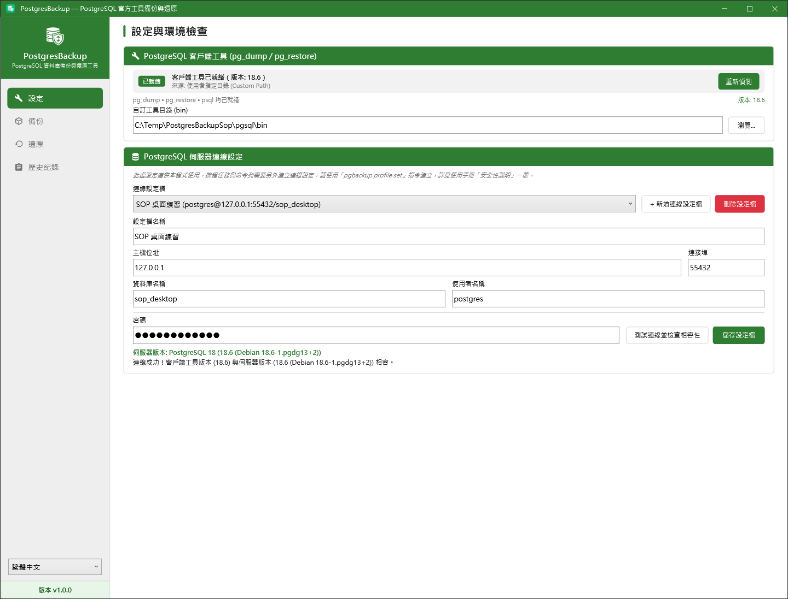
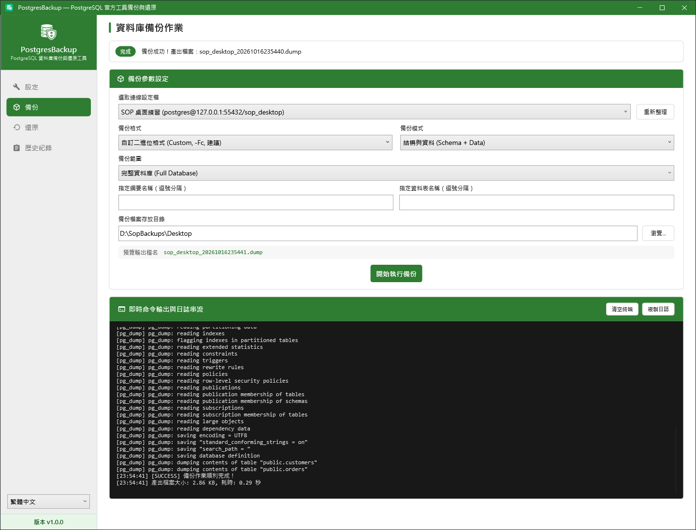
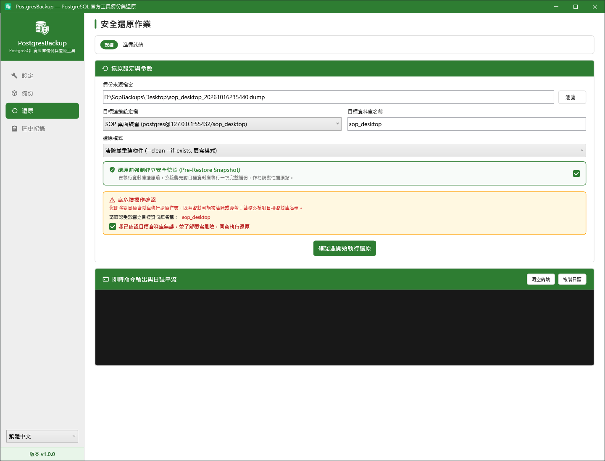
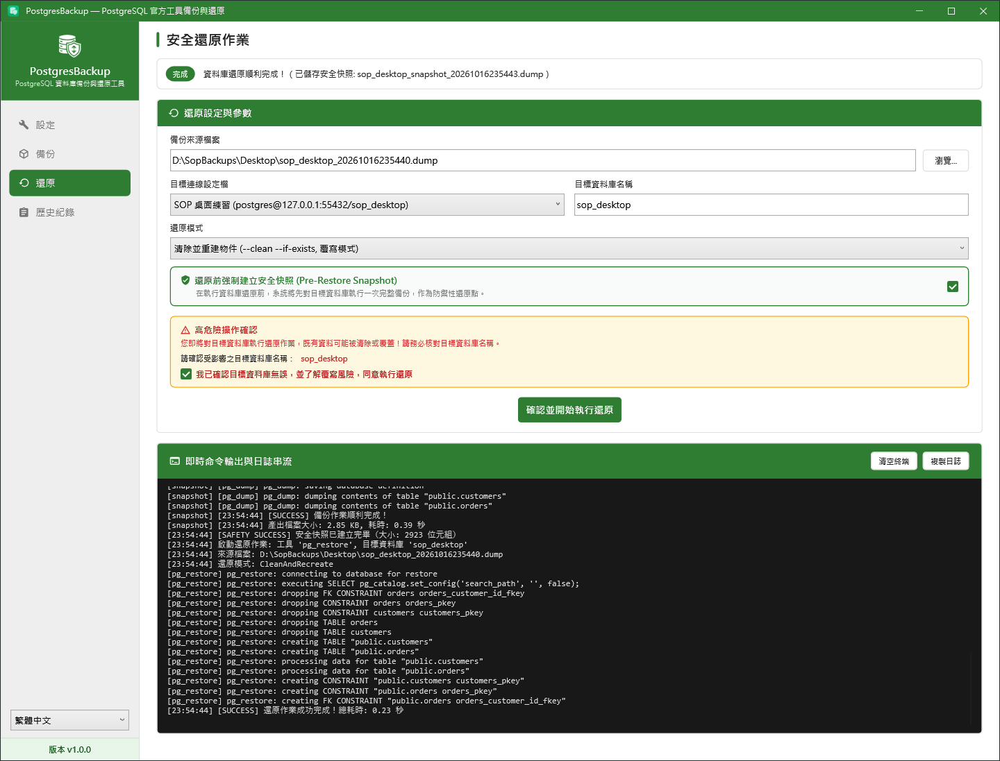
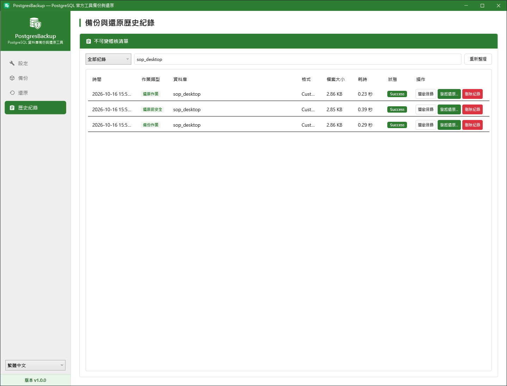
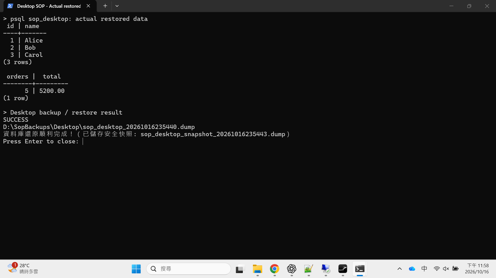

# 桌面版備份與還原手冊

這份手冊用 Windows 桌面程式，把 `sop_desktop` 備份成檔案，故意改壞測試資料，再把它還原回來。正式操作時，把主機、資料庫和目錄換成自己的環境。

## 1. 準備程式與 PostgreSQL 工具

| 要準備什麼 | 下載與操作 |
| --- | --- |
| PostgresBackup 桌面程式 | 向交接人取得 `PostgresBackup.Wpf.exe`；也可到[專案原始碼](https://github.com/lawrence8358/PostgresBackup)按 **Code → Download ZIP**，解壓後依下方指令建置。2026-10-16 查核時，[Releases](https://github.com/lawrence8358/PostgresBackup/releases) 尚未提供可下載套件。 |
| PostgreSQL 18 工具 | 到 [EDB 官方 ZIP 下載頁](https://www.enterprisedb.com/download-postgresql-binaries)選 Windows x86-64，解壓至例如 `C:\Tools\pgsql`。資料夾內的 `bin` 必須有 `pg_dump.exe`、`pg_restore.exe`、`psql.exe`。也可用 [PostgreSQL 官方 Windows 安裝程式](https://www.postgresql.org/download/windows/)。 |
| .NET 10 SDK（自己建置才需要） | 到 [Microsoft 下載頁](https://dotnet.microsoft.com/en-us/download/dotnet/10.0)選 **SDK / Windows / x64**。已拿到完整發行程式的人不用另外裝。 |

自己建置時，在原始碼根目錄開 PowerShell，執行：

```powershell
dotnet publish .\src\PostgresBackup.Wpf\PostgresBackup.Wpf.csproj -c Release -r win-x64 --self-contained true -p:PublishSingleFile=true -p:IncludeNativeLibrariesForSelfExtract=true -o .\dist\wpf
.\dist\wpf\PostgresBackup.Wpf.exe
```

本次練習連線如下。這是本機 Docker 測試庫，不能拿來當正式環境帳密。

| 欄位 | 練習值 |
| --- | --- |
| 設定檔名稱 | SOP 桌面練習 |
| 主機 | `127.0.0.1` |
| 連接埠 | `55432` |
| 資料庫 | `sop_desktop` |
| 帳號 | `postgres` |
| 密碼 | `SopDemo2026!` |
| 備份目錄 | `D:\SopBackups\Desktop`（沒有 D 槽可改成 `C:\SopBackups\Desktop`） |

## 2. 儲存連線並測試

1. 開啟桌面程式，左下角可切換「繁體中文」。
2. 進入左側「設定」，在自訂工具路徑填入 `C:\Tools\pgsql\bin`，按「重新偵測」。看到工具就緒即可。
3. 按「新增連線設定檔」，填入上表資料，按「測試連線」。
4. 確認連線成功後按「儲存設定檔」。下次便可直接選這個設定檔。

工具版本至少要和伺服器一樣新；這次使用 PostgreSQL 18.6 伺服器與 18.6 版工具。截圖中的工具解壓在 `C:\Temp\PostgresBackupSop\pgsql\bin`，請填你實際解壓的位置。若顯示不相容，先更新工具，不要直接開始備份。



## 3. 建立完整備份

1. 點左側「備份」，選「SOP 桌面練習」。
2. 備份格式選「自訂二進位格式（Custom）」。
3. 備份模式選「結構與資料」，範圍選「完整資料庫」。
4. 輸出目錄填 `D:\SopBackups\Desktop`，按「開始執行備份」。
5. 等上方顯示「完成」，到輸出目錄確認有 `.dump` 檔。記下檔名，還原時會用到。

檔名裡的數字是備份時間，例如 `sop_desktop_20261016235440.dump`。你的時間會不同，請挑自己剛做好的檔案。



練習時，備份完成後可在 PowerShell 對測試庫故意修改資料，再接著做下一節還原。只對 `sop_desktop` 執行：

```powershell
docker exec sop-postgres psql -U postgres -d sop_desktop -c "UPDATE customers SET name='CHANGED' WHERE id=1; DELETE FROM orders WHERE id=5; SELECT id,name FROM customers ORDER BY id; SELECT count(*) AS orders,sum(amount) AS total FROM orders;"
```

應看到第一位客戶變成 CHANGED、訂單剩 4 筆、合計 4580.00。不要再對這個狀態覆蓋原本的備份。

## 4. 還原前確認資料庫與檔案

還原會把備份包含的物件與資料改回備份當時的狀態；先讓使用這個資料庫的服務停止寫入，再繼續。

1. 點左側「還原」，瀏覽並選取剛才的 `.dump`。
2. 目標連線設定檔選「SOP 桌面練習」，確認「目標資料庫名稱」是 `sop_desktop`。
3. 還原模式選「清除並重建物件（覆寫模式）」。這適合把現有測試庫回復到完整備份；選「一般還原」可能會碰到原本已存在的資料表。
4. 保留「還原前強制建立安全快照」的勾選。程式會先備份目前目標資料庫，再還原；快照失敗就不會繼續。
5. 核對畫面顯示的目標名稱，勾選「我已確認目標資料庫無誤，並了解覆寫風險，同意執行還原」。
6. 按「確認並開始執行還原」，等上方顯示完成。

目標資料庫必須先存在。若是新環境，先用 pgAdmin 或 `createdb` 建立空資料庫，再在設定頁新增它的連線。





快照會放在這次備份目錄下的 `snapshots` 資料夾，檔名含 `_snapshot_`。如果選錯備份，可以再用同一個還原流程，改選該快照檔，把資料回到這次還原之前。

## 5. 確認真的還原成功

左側「歷史紀錄」輸入 `sop_desktop` 篩選，應看到備份、安全快照、還原的成功紀錄。



接著用你平常的資料庫查詢工具查資料。若只有 PostgreSQL 工具，可在 PowerShell 執行下列指令；`-W` 會詢問密碼：

```powershell
& 'C:\Tools\pgsql\bin\psql.exe' -h 127.0.0.1 -p 55432 -U postgres -d sop_desktop -W -c 'SELECT id,name FROM customers ORDER BY id; SELECT count(*) AS customers FROM customers; SELECT count(*) AS orders, sum(amount) AS total FROM orders;'
```

2026-10-16 實際操作後，用 `psql` 查到的結果如下：

| 階段 | 客戶數 | 第一位客戶 | 訂單數 | 訂單合計 |
| --- | ---: | --- | ---: | ---: |
| 備份前 | 3 | Alice | 5 | 5200.00 |
| 刪除最後一筆訂單、改掉客戶姓名後 | 3 | CHANGED | 4 | 4580.00 |
| 用桌面版還原後 | 3 | Alice | 5 | 5200.00 |

其他兩位客戶為 Bob、Carol。這次備份檔為 `sop_desktop_20261016235440.dump`，快照檔為 `snapshots\sop_desktop_snapshot_20261016235443.dump`。正式接手時也要挑選已知資料核對，不能只看「完成」兩個字。



## 遇到問題怎麼辦

| 畫面或情況 | 做法 |
| --- | --- |
| 找不到工具 | 回「設定」填入真正包含三個 `.exe` 的 `bin` 目錄，再重新偵測。 |
| 無法連線 | 檢查主機、連接埠、帳密與 PostgreSQL 是否啟動；這次是 Docker 的 `55432`，不是預設 `5432`。 |
| 還原按鈕不能按 | 確認已選備份檔、連線設定檔並勾選風險確認。 |
| 快照或還原失敗 | 展開錯誤詳細資料或複製日誌，先處理磁碟空間、權限或連線問題，再重試；先保留原備份與快照。 |
| 排程紀錄沒有出現在桌面歷史 | Windows 排程用 SYSTEM 執行時有自己的歷史檔，請看排程日誌與備份檔。 |

桌面連線設定存在目前使用者帳號下；CLI 排程使用另一套設定檔。後續要設定排程，請接著看 [Windows CLI 手冊](windows-cli.md)。


