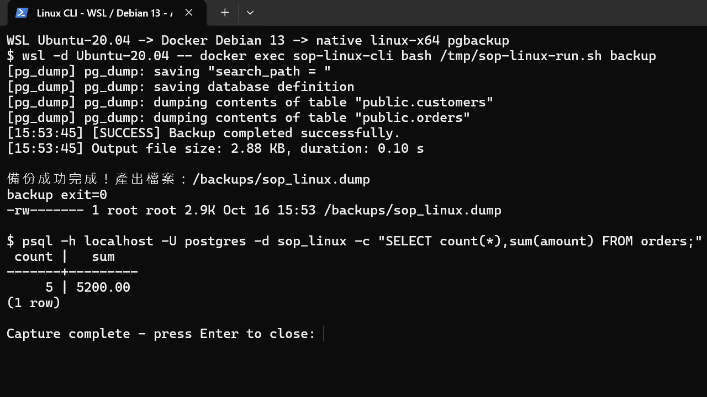
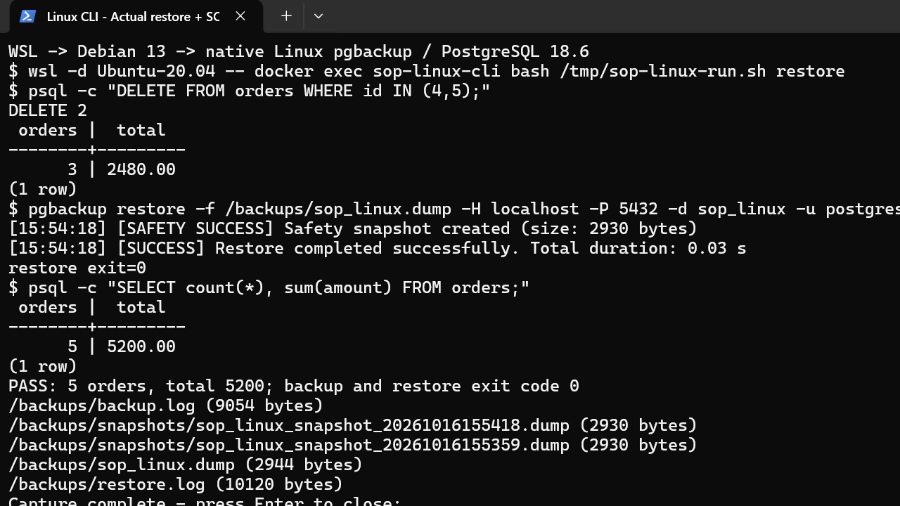

# Linux CLI 備份與還原手冊

這份手冊實際跑過 Linux 版 `pgbackup`。本次環境是 Windows 的 WSL 2 → Docker 中的 Debian 13，客戶端工具與資料庫都是 PostgreSQL 18.6。備份、刪除測試資料、還原和 SQL 核對都在 Linux 完成。

2026-10-16 查核時，專案 Releases 尚無可下載套件，所以本手冊由原始碼建置 Linux 執行檔。`profile set` 的加密存放區使用 Windows 功能；Linux 請使用下面的 `.pgpass` 做密碼驗證。

## 1. 準備工具

需要安裝的工具都有官方連結：

| 工具 | 下載或安裝說明 |
| --- | --- |
| Docker Desktop | [Windows 安裝說明](https://docs.docker.com/desktop/setup/install/windows-install/) |
| WSL 2 | [Microsoft WSL 安裝說明](https://learn.microsoft.com/windows/wsl/install) |
| .NET 10 SDK，只用於建置 | [.NET 10 下載頁](https://dotnet.microsoft.com/en-us/download/dotnet/10.0)，請選 SDK |
| 專案原始碼 | [PostgresBackup](https://github.com/lawrence8358/PostgresBackup) |
| Linux PostgreSQL 工具 | 本次由 [PostgreSQL Docker 官方映像檔](https://hub.docker.com/_/postgres)提供；原生 Ubuntu 安裝方式見[官方說明](https://www.postgresql.org/download/linux/ubuntu/) |

你已經有 Docker、WSL，就從下一步開始。Docker Desktop 設定中的「Resources → WSL Integration」要啟用你的 Ubuntu。

## 2. 準備 Linux 執行檔

在 Windows PowerShell 進入專案根目錄，執行：

```powershell
dotnet publish src/PostgresBackup.Cli/PostgresBackup.Cli.csproj `
  -c Release -r linux-x64 --self-contained true `
  -p:PublishSingleFile=true -o C:\Tools\PostgresBackupLinux
```

輸出資料夾裡的 `pgbackup` 是 Linux 執行檔；`libe_sqlite3.so` 也要一起保留，別只複製 `pgbackup`。

## 3. 開啟 Linux 操作環境

先依[操演入口](README.md)準備測試容器 `sop-postgres` 和測試資料庫 `sop_linux`。測試資料是 3 位客戶、5 筆訂單，金額合計 5200。

在 PowerShell 執行下面指令，建立獨立的 Linux 操作容器。`C:\Backups\LinuxSop` 會保留備份檔案，即使日後移除操作容器，檔案仍留在 Windows。

```powershell
New-Item -ItemType Directory -Force C:\Backups\LinuxSop
docker run -d --name sop-linux-cli --network container:sop-postgres `
  --mount "type=bind,source=C:\Tools\PostgresBackupLinux,target=/opt/pgbackup" `
  --mount "type=bind,source=C:\Backups\LinuxSop,target=/backups" `
  --entrypoint bash postgres:18.6 -lc "sleep infinity"
```

若是沿用本次已建好的 `sop-linux-cli`，就不用重建。先在 PowerShell 列出已安裝的 WSL 發行版：

```powershell
wsl -l -q
```

下方的 `Ubuntu-20.04` 是本次實測名稱，請換成你清單中的實際名稱，例如 `Ubuntu`。再到 Docker Desktop 的 **Settings → Resources → WSL Integration**，啟用該發行版並按 **Apply & restart**。進入 Linux：

```powershell
wsl -d Ubuntu-20.04 -- docker exec -it sop-linux-cli bash
```

接下來的指令都在這個 Linux shell 執行。

```bash
chmod +x /opt/pgbackup/pgbackup
export PATH=/opt/pgbackup:/usr/lib/postgresql/18/bin:$PATH
uname -srm
pgbackup check-tools --pg-bin-path /usr/lib/postgresql/18/bin
```

看到 `Linux` 與 `READY`，以及 `pg_dump`、`pg_restore`、`psql` 都是 18.6，就可以繼續。本次用容器內的工具，避開舊 Ubuntu 20.04 無法直接從目前 PGDG 套件庫安裝 PostgreSQL 18 的問題。

| 連線位置 | 主機與連接埠 |
| --- | --- |
| 這個 Linux 容器，共用測試資料庫容器網路 | `localhost:5432` |
| Windows 桌面或 Windows CLI | `127.0.0.1:55432` |

不要把 Windows 的 `55432` 填到本手冊的 Linux 指令中。

## 4. 設定密碼

輸入以下指令，提示時輸入測試資料庫密碼。輸入過程不會顯示在畫面上；測試環境的密碼見操演入口。

```bash
umask 077
read -rsp '資料庫密碼：' DB_PASSWORD; echo
DB_PASSWORD=${DB_PASSWORD//\\/\\\\}
DB_PASSWORD=${DB_PASSWORD//:/\\:}
printf 'localhost:5432:sop_linux:postgres:%s\n' "$DB_PASSWORD" > ~/.pgpass
unset DB_PASSWORD
chmod 600 ~/.pgpass

export PGHOST=localhost PGPORT=5432 PGUSER=postgres PGDATABASE=sop_linux
psql -X -c 'SELECT count(*) AS orders, sum(amount) AS total FROM orders;'
```

預期是 `5` 和 `5200.00`。[`.pgpass` 是 PostgreSQL 支援的密碼檔](https://www.postgresql.org/docs/current/libpq-pgpass.html)，內容為明文，因此只讓目前帳號讀寫；不要把它放進 Git，也不用開啟後截圖。正式環境請用實際主機、資料庫和帳號取代測試值。

## 5. 執行備份

```bash
mkdir -p /backups
pgbackup backup -H localhost -P 5432 -d sop_linux -u postgres \
  -f custom -o /backups --output-file sop_linux.dump \
  --pg-bin-path /usr/lib/postgresql/18/bin \
  --log /backups/backup.log
echo "backup exit=$?"
ls -lh /backups/sop_linux.dump
```

看到「備份成功完成」、`backup exit=0`，並確認檔案大小大於 0。本次約 2.9 KB。重複操演會使用同一個檔名；正式備份請省略 `--output-file`，讓工具自動以資料庫名稱與時間命名。



截圖使用放在暫存目錄的操演腳本執行同一組命令；畫面保留成功訊息、退出碼和 SQL 結果。操演腳本沒有簽入。

## 6. 在測試資料庫模擬誤刪

**只對 `sop_linux` 測試資料庫執行。** 先確認目前連到哪個資料庫：

```bash
psql -X -c 'SELECT current_database();'
psql -X -v ON_ERROR_STOP=1 -c 'DELETE FROM orders WHERE id IN (4,5);'
psql -X -c 'SELECT count(*) AS orders, sum(amount) AS total FROM orders;'
```

本次刪掉 2 筆訂單，剩下 3 筆，總額變成 `2480.00`。這時先不要再備份到 `sop_linux.dump`，否則會覆蓋原本正確的備份。

## 7. 還原並確認資料回來

先讓使用資料庫的程式暫停寫入。確認目標是測試資料庫後，執行：

```bash
pgbackup restore -f /backups/sop_linux.dump \
  -H localhost -P 5432 -d sop_linux -u postgres \
  -m clean -y --pg-bin-path /usr/lib/postgresql/18/bin \
  --log /backups/restore.log
echo "restore exit=$?"

psql -X -c 'SELECT count(*) AS customers FROM customers;'
psql -X -c 'SELECT count(*) AS orders, sum(amount) AS total FROM orders;'
ls -lh /backups/snapshots/
```

`-m clean` 會清除備份涵蓋的物件後重建；`-y` 代表你已確認要執行，正式作業要先核對資料庫名稱。這裡保留預設的還原前安全快照，工具會先把誤刪後的狀態備份到 `/backups/snapshots/`，成功後才開始還原。

完成時應看到 `restore exit=0`，客戶數是 `3`，訂單數是 `5`，總額是 `5200.00`。本次也確認安全快照實際存在，檔案大小為 2930 bytes。



## 8. 把備份帶走

如果依本手冊建立有掛載 `/backups` 的操作容器，直接到 Windows 的 `C:\Backups\LinuxSop` 取檔。

本次實際操演的操作容器使用容器內的 `/backups`；若沿用這個容器，請回到 PowerShell 額外執行下列指令，把備份和安全快照複製出來：

```powershell
New-Item -ItemType Directory -Force C:\Backups\LinuxSop
docker cp sop-linux-cli:/backups/. C:\Backups\LinuxSop
```

確認 `.dump`、`backup.log`、`restore.log` 和 `snapshots` 都已保存，再交接或清理容器。

## 常見卡關

| 畫面或問題 | 處理方式 |
| --- | --- |
| `Permission denied`，無法執行 `pgbackup` | 再執行 `chmod +x /opt/pgbackup/pgbackup`。 |
| `password authentication failed` | 檢查 `.pgpass` 的主機、連接埠、資料庫、帳號是否與命令一致，再重新輸入密碼；檔案權限必須是 `600`。 |
| 找不到客戶端工具 | 保留 `--pg-bin-path /usr/lib/postgresql/18/bin`，先跑 `check-tools`。 |
| 客戶端版本比伺服器舊 | 安裝同主版本或更新版的客戶端工具；本次兩邊均為 18.6。 |
| 想在原生 Linux 上執行 | 使用 `linux-x64` 產物並保留旁邊的 `.so`，依發行版官方方式裝 PostgreSQL 客戶端；把工具路徑、備份路徑和資料庫位址換成實際值。原生 Linux 主機不需要本手冊的 WSL／Docker 啟動步驟；本次驗證範圍為上述 Debian 容器。 |
| 還原失敗 | 先看 `/backups/restore.log`。安全快照若已成功產生，請保留該檔；修正原因後再重試，不要直接關閉安全快照。 |

