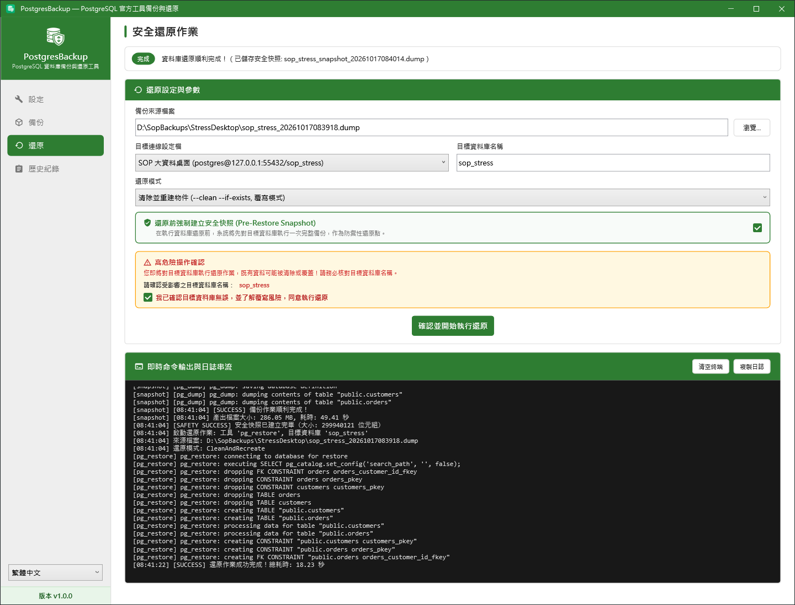
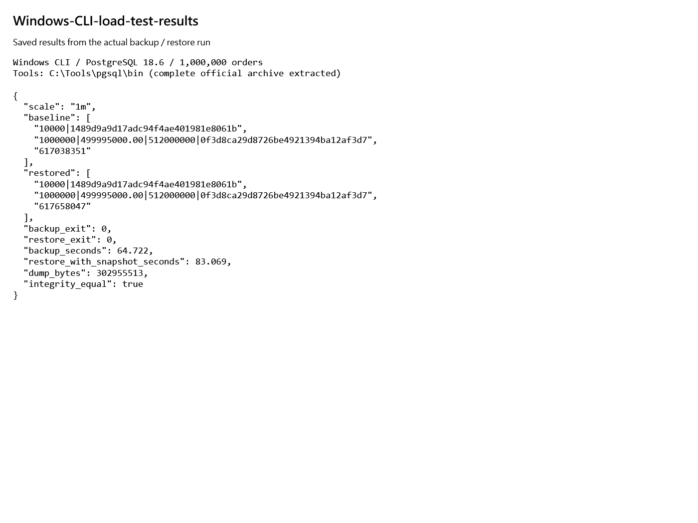
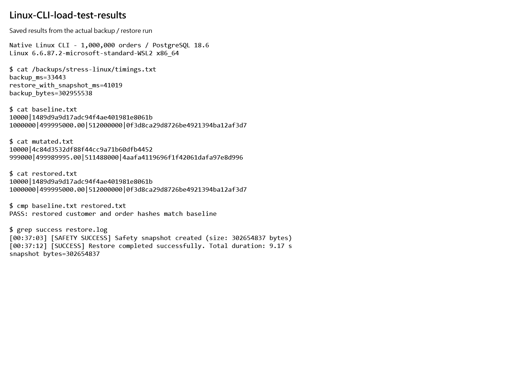

# 大資料備份與還原測試

使用獨立的 `sop_stress` 測試庫，原本三個練習庫不會受影響。這是單機、依序執行的備份與還原負載測試，沒有測並行交易或 TPS。

## 1. 建立 100 萬筆訂單

先依[練習環境](README.md)啟動 `sop-postgres`。請預留至少 10 GB 空間，並只對新建的 `sop_stress` 執行下列 SQL。

在 Windows PowerShell 建庫，再開啟 SQL 終端：

```powershell
docker exec sop-postgres createdb -U postgres sop_stress
docker exec -it sop-postgres psql -U postgres -d sop_stress
```

若提示資料庫已存在，先確認是否保留了上次資料，**不要直接重新灌入或刪庫**。以下建表與插入只做一次：

```sql
CREATE TABLE customers(id integer PRIMARY KEY, name text NOT NULL, email text NOT NULL);
INSERT INTO customers
SELECT g, 'Customer-'||g, 'user'||g||'@example.invalid'
FROM generate_series(1,10000) g;

CREATE TABLE orders(
  id bigint PRIMARY KEY,
  customer_id integer NOT NULL REFERENCES customers(id),
  amount numeric(12,2) NOT NULL,
  payload text NOT NULL
);
INSERT INTO orders
SELECT g, (g%10000)+1, (g%100000)::numeric/100,
       (SELECT string_agg(md5(g::text||':'||s::text),'')
        FROM generate_series(1,16) s)
FROM generate_series(1,1000000) g;
ANALYZE;
```

每筆訂單含 512 字元合成內容。若先試 10 萬筆，將最後一行 `generate_series(1,1000000)` 改成 `generate_series(1,100000)`；要擴充到百萬筆，再用相同 INSERT，將範圍改成 `generate_series(100001,1000000)`。

SQL 執行完成後，輸入 `\q` 回到 PowerShell。下節刪改與核對 SQL 可用同一條 `docker exec -it ... psql` 命令重新進入。

## 2. 備份、故意改壞、還原

依[桌面](desktop.md)、[Windows CLI](windows-cli.md)或 [Linux CLI](linux-cli.md)手冊操作，使用以下設定：

| 項目 | 壓測值 |
| --- | --- |
| 桌面連線設定／目標資料庫 | 新增名為「SOP 大資料桌面」的設定，資料庫填 `sop_stress` |
| CLI 資料庫參數 | `-d sop_stress` |
| 密碼檔 | 依下方指令另建壓測用密碼檔，不覆蓋原練習檔 |
| Windows 輸出目錄 | `C:\Backups\PostgresBackupStress` |
| Linux 輸出目錄 | `/backups/stress-linux` |
| 手動指定檔名時 | 使用 `sop_stress.dump`；還原務必選這份壓測檔 |

Windows：先完成 Windows CLI 手冊第 2 節，在**同一個 PowerShell 視窗**執行。`$passFile` 是該節建立的 `%LOCALAPPDATA%\PostgresBackupSop\pgpass.conf`；此段沿用密碼、不印出密碼，並將 `$passFile` 切換成壓測檔，供後續 Windows 還原步驟沿用：

```powershell
$entry = @(Get-Content -LiteralPath $passFile | Where-Object { $_.StartsWith('127.0.0.1:55432:sop_windows:postgres:') })[0]
if (-not $entry) { throw '找不到練習庫的密碼項，先完成 Windows CLI 第 2 節' }
$stressPassFile = Join-Path (Split-Path $passFile) 'stress-pgpass.conf'
$entry = $entry -replace '^127\.0\.0\.1:55432:sop_windows:postgres:', '127.0.0.1:55432:sop_stress:postgres:'
[IO.File]::WriteAllText($stressPassFile, "$entry`n", [Text.UTF8Encoding]::new($false))
$me = [Security.Principal.WindowsIdentity]::GetCurrent().Name
icacls.exe $stressPassFile /reset
if ($LASTEXITCODE -ne 0) { throw '無法重設壓測密碼檔權限' }
icacls.exe $stressPassFile /inheritance:r /grant:r "$($me):(F)"
if ($LASTEXITCODE -ne 0) { throw '無法限制壓測密碼檔權限' }
$passFile = $stressPassFile
$env:PGPASSFILE = $stressPassFile
$entry = $null
```

Linux：先完成 Linux 手冊第 3 節，在 `sop-linux-cli` 的 Linux shell 執行，另建 `~/.pgpass-stress` 並切換資料庫：

```bash
umask 077
sed 's/^localhost:5432:sop_linux:postgres:/localhost:5432:sop_stress:postgres:/' ~/.pgpass > ~/.pgpass-stress
chmod 600 ~/.pgpass-stress
export PGPASSFILE="$HOME/.pgpass-stress" PGDATABASE=sop_stress
```

接著開始測試。核對 SQL 一律在本頁 `docker exec -it sop-postgres psql -U postgres -d sop_stress` 的 SQL 終端執行，避免仍連到小型練習庫。

1. 先執行下節 SQL，保留完整結果。
2. 完成 Custom 格式完整備份。
3. 只對 `sop_stress` 執行：

```sql
UPDATE customers SET name='CHANGED' WHERE id=1;
DELETE FROM orders WHERE id<=1000;
```

4. 用清除並重建還原模式還原，保留預設安全快照。
5. 再執行相同核對 SQL。兩個 MD5、筆數、金額與 payload 大小必須與備份前一致。

## 3. 核對所有資料內容

```sql
SELECT count(*) AS customers,
       md5(string_agg(md5(id::text||'|'||name||'|'||email),'' ORDER BY id)) AS customers_md5
FROM customers;

SELECT count(*) AS orders, sum(amount) AS total,
       sum(octet_length(payload)) AS payload_bytes,
       md5(string_agg(md5(id::text||'|'||customer_id::text||'|'||amount::text||'|'||payload),'' ORDER BY id)) AS orders_md5
FROM orders;

SELECT pg_database_size(current_database()) AS database_bytes;
```

百萬筆預期值：客戶 `10000`、訂單 `1000000`、金額 `499995000.00`、payload `512000000` bytes。客戶 MD5 為 `1489d9a9d17adc94f4ae401981e8061b`，訂單 MD5 為 `0f3d8ca29d8726be4921394ba12af3d7`。

資料庫實體大小在還原後可能不同，不以此判斷資料一致。MD5 在此用來核對合成資料，並非安全簽章。

## 實測結果

2026-10-17，Windows 11 / WSL 2、PostgreSQL 18.6；資料庫約 617 MB（589 MiB）。Windows 使用完整 EDB ZIP 解壓後的 `C:\Tools\pgsql\bin`，Linux 使用容器內 `/usr/lib/postgresql/18/bin`，均通過 `check-tools`。三條路徑依序執行，沒有同時備份或還原。

| 操作路徑 | 訂單筆數 | 備份檔 bytes | 備份秒數 | 還原秒數（含安全快照） | 結果 |
| --- | ---: | ---: | ---: | ---: | --- |
| Windows CLI | 100,000 | 30,334,726 | 13.442 | 12.326 | 退出碼皆 0，兩表完整內容一致 |
| Windows CLI | 1,000,000 | 302,955,513 | 64.722 | 83.069 | 退出碼皆 0，兩表完整內容一致 |
| Linux CLI | 1,000,000 | 302,955,538 | 33.443 | 41.019 | 退出碼皆 0，兩表完整內容一致 |
| Windows 桌面 | 1,000,000 | 302,955,513 | 53.407 | 68.049 | UI 完成，兩表完整內容一致 |

100 萬筆 Windows CLI 測試刪除 1,000 筆訂單並更改一位客戶，修改後兩表 MD5 均不同；還原後回到上方預期 MD5。每次測試保留安全快照，耗時從操作啟動計至完成，不包含事後核對 SQL。

桌面秒數包含按鈕與畫面處理；引擎日誌另記備份 51.83 秒、安全快照 49.41 秒、還原 18.23 秒。桌面測試刪除 10,000 筆訂單並改客戶名後再還原，最後兩表筆數與完整 MD5 均與基準相同。







Windows 與 Linux 圖是結果檢視視窗直接讀取實跑保存的 JSON / 文字結果後擷取，原始日誌保存在本機暫存目錄；不是終端畫面。桌面鎖定時無法取得一般螢幕畫面，因此採此方式保留可讀證據。

這些時間只代表本機單次操作，不用來比較平台快慢，也不能推算正式環境容量或並行交易表現。其他程式、磁碟快取與 Windows / Linux 到資料庫的路徑不同，都會影響耗時。

## 留給接手者的資料

- 測試資料仍保留在 Docker 容器 `sop-postgres` 的 `sop_stress`；Windows 連 `127.0.0.1:55432`，帳號 `postgres`，密碼沿用練習環境。
- 已驗證的百萬筆備份保留於 `C:\Backups\PostgresBackupStress\sop_stress_1m.dump`（302,955,513 bytes）。可直接以任一手冊還原到獨立測試庫。
- 備份檔 SHA-256：`06d80865f8799b9e061148b3d24d685dadbe45c453a405be8ec2e959679b70f3`。
- 實跑原始日誌與數據保存在 `%TEMP%\sop-stress-linux-evidence`、`%TEMP%\pgbackup-desktop-stress`、`C:\Temp\PostgresBackupSop\stress`；圖中各測試輸出目錄的重複 dump / 安全快照已清除，只保留上列交接備份。

不再需要壓測資料時，下面兩行會永久刪除**壓測庫與保留備份**，不影響三個小型練習庫。確認不需保留才執行：

```powershell
docker exec sop-postgres dropdb -U postgres sop_stress
Remove-Item -LiteralPath 'C:\Backups\PostgresBackupStress\sop_stress_1m.dump'
```
