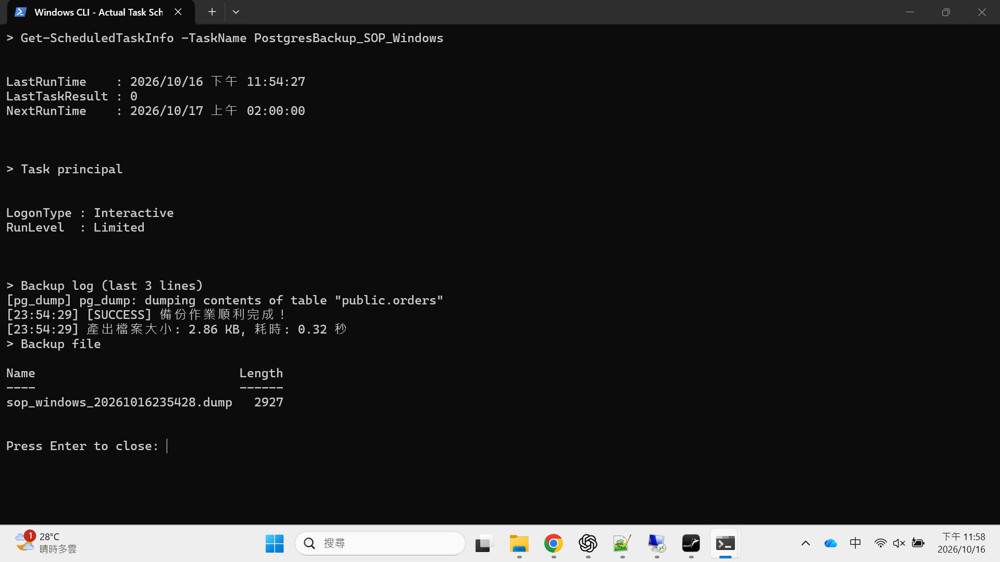
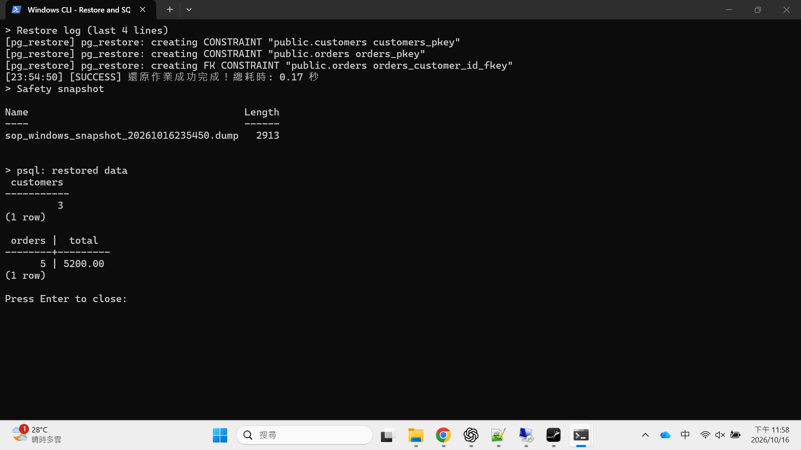

# Windows CLI 排程備份與還原手冊

先依[練習環境](README.md)建立資料庫，再用同一個 PowerShell 視窗完成下列步驟。此排程使用目前帳號，**登出後不會執行**；無人登入的方案見文末。

## 1. 準備工具

- [PostgresBackup 原始碼](https://github.com/lawrence8358/PostgresBackup)：按 Code → Download ZIP，解壓到固定位置。2026-10-16 查核 [Releases](https://github.com/lawrence8358/PostgresBackup/releases) 尚無可下載的版本，請向交接人取得 `pgbackup.exe`，或依下一段建置。
- [Microsoft .NET 10 SDK](https://dotnet.microsoft.com/en-us/download/dotnet/10.0)：選 Windows x64 SDK；只有自己建置才需要。
- [PostgreSQL Windows 官方工具 ZIP](https://www.enterprisedb.com/download-postgresql-binaries)：選 PostgreSQL 18 / Windows x86-64。在 ZIP 上按右鍵「全部解壓縮」，目的地選 `C:\Tools`；將包內整個 `pgsql` 資料夾保留，所有子目錄與檔案都不要挑選或刪除。解壓後必須是 `C:\Tools\pgsql\bin\pg_dump.exe`，不可多一層 `pgsql\pgsql`。桌面工具目錄與 CLI `--pg-bin-path` 都填 `C:\Tools\pgsql\bin`。

在解壓後含有 `PostgresBackup.sln` 與 `src` 的資料夾開 PowerShell，再建置 CLI（不是在 `C:\Tools\pgsql`）：

```powershell
dotnet publish .\src\PostgresBackup.Cli -c Release -r win-x64 --self-contained true -p:PublishSingleFile=true -p:IncludeNativeLibrariesForSelfExtract=true -o C:\Tools\PostgresBackup
```

以下命令直接操作練習庫 `sop_windows`。正式環境請先替換所有命令與密碼檔中的主機、連接埠、資料庫、帳號及備份目錄。

```powershell
$cli = 'C:\Tools\PostgresBackup\pgbackup.exe'
$pg = 'C:\Tools\pgsql\bin'
$backupDir = 'C:\Backups\sop_windows'
New-Item -ItemType Directory -Force $backupDir | Out-Null
& $cli check-tools --pg-bin-path $pg
```

看到 `READY`、工具版本 18.x 才繼續。測試庫由 [練習環境說明](README.md)準備。

## 2. 準備排程帳號的密碼檔

使用 [PGPASSFILE 密碼檔](https://www.postgresql.org/docs/18/libpq-pgpass.html)。內容是明文，下方指令會限制為目前帳號讀取；不要放進共用目錄或 Git。

執行整段，提示時輸入資料庫密碼：

```powershell
$passDir = Join-Path $env:LOCALAPPDATA 'PostgresBackupSop'
New-Item -ItemType Directory -Force $passDir | Out-Null
$passFile = Join-Path $passDir 'pgpass.conf'
$secure = Read-Host '輸入 postgres 的資料庫密碼' -AsSecureString
$ptr = [Runtime.InteropServices.Marshal]::SecureStringToBSTR($secure)
try {
    $password = [Runtime.InteropServices.Marshal]::PtrToStringBSTR($ptr)
    $escaped = $password.Replace('\','\\').Replace(':','\:')
    [IO.File]::WriteAllText($passFile, "127.0.0.1:55432:sop_windows:postgres:$escaped`n", [Text.UTF8Encoding]::new($false))
} finally {
    [Runtime.InteropServices.Marshal]::ZeroFreeBSTR($ptr)
    $password = $null
    $escaped = $null
}
$me = [Security.Principal.WindowsIdentity]::GetCurrent().Name
icacls.exe $passFile /reset
if ($LASTEXITCODE -ne 0) { throw '無法重設密碼檔權限' }
icacls.exe $passFile /inheritance:r /grant:r "$($me):(F)"
if ($LASTEXITCODE -ne 0) { throw '無法限制密碼檔權限' }
$env:PGPASSFILE = $passFile
```

先手動備份一次，確認連線與工具都正常：

```powershell
& $cli backup -H 127.0.0.1 -P 55432 -d sop_windows -u postgres -f custom -o $backupDir --pg-bin-path $pg
if ($LASTEXITCODE -ne 0) { throw '備份失敗，先處理錯誤再設定排程' }
Get-ChildItem $backupDir -Filter '*.dump' | Select-Object Name, Length, LastWriteTime
```

## 3. 建立每天 02:00 的排程並試跑

延續上面的 PowerShell 變數，執行以下指令。路徑請使用一般資料夾名稱，不包含單引號。

```powershell
$log = Join-Path $backupDir 'scheduled.log'
$command = "`$env:PGPASSFILE = '$passFile'; & '$cli' backup -H 127.0.0.1 -P 55432 -d sop_windows -u postgres -f custom -o '$backupDir' --pg-bin-path '$pg' --log '$log'; exit `$LASTEXITCODE"
$action = New-ScheduledTaskAction -Execute 'powershell.exe' -Argument ('-NoProfile -NonInteractive -Command "' + $command + '"')
$trigger = New-ScheduledTaskTrigger -Daily -At '02:00'
$principal = New-ScheduledTaskPrincipal -UserId $me -LogonType Interactive -RunLevel Limited
Register-ScheduledTask -TaskName 'PostgresBackup_SOP_Windows' -Action $action -Trigger $trigger -Principal $principal
Start-ScheduledTask -TaskName 'PostgresBackup_SOP_Windows'
```

等數秒後檢查：

```powershell
Get-ScheduledTaskInfo -TaskName 'PostgresBackup_SOP_Windows' | Select-Object LastRunTime, LastTaskResult, NextRunTime
Get-Content $log -Encoding UTF8 -Tail 6
Get-ChildItem $backupDir -Filter '*.dump' | Select-Object Name, Length, LastWriteTime
```

`LastTaskResult` 要是 `0`，日誌要有 `SUCCESS`，而且要有這一輪產生、大小大於 0 的 `.dump`。`267009` 表示仍在執行，稍等再查。



按 Win + R，輸入 `taskschd.msc` 也能找到這個任務。鎖定螢幕仍保有登入狀態；登出、關機、休眠時不會按時執行這個版本的排程。備份檔請另外複製到另一台主機或備份儲存空間，並定期確認空間。

## 4. 練習誤刪資料

只對測試庫執行。先確認已有成功備份，再刪兩筆訂單：

```powershell
docker exec sop-postgres psql -U postgres -d sop_windows -c 'DELETE FROM orders WHERE id IN (4,5); SELECT count(*) AS orders, sum(amount) AS total FROM orders;'
```

預期剩 3 筆、合計 `2480.00`。接著還原。

## 5. 從備份還原

先停止應用程式寫入資料，再確認目標資料庫。目標資料庫必須已存在。請選定你要回去的那一份檔案，不要直接照抄截圖時間。

```powershell
$env:PGPASSFILE = $passFile
Get-ChildItem $backupDir -Filter '*.dump' | Select-Object Name, LastWriteTime
$file = Read-Host '貼上 dump 完整路徑（不用加引號）'
& $cli restore -f $file -H 127.0.0.1 -P 55432 -d sop_windows -u postgres -m clean --pg-bin-path $pg --log (Join-Path $backupDir 'restore.log')
```

程式會要求確認，核對目標名稱後照畫面輸入。`clean` 會清除並重建備份中的物件。保留預設的還原前安全快照；它會放在來源備份檔旁的 `snapshots`，必須有足夠空間。

本次自動操演使用 `--yes` 接受確認，安全快照仍有建立。手動操作照上面的指令保留互動確認即可。

還原成功後，用 SQL 核對：

```powershell
& "$pg\psql.exe" -h 127.0.0.1 -p 55432 -U postgres -d sop_windows -P pager=off -c 'SELECT count(*) AS customers FROM customers; SELECT count(*) AS orders, sum(amount) AS total FROM orders;'
```

還原後應恢復為 3 位客戶、5 筆訂單、合計 `5200.00`。



如果這次選錯備份，可將 `$file` 改成對應的 `snapshots\..._snapshot_...dump` 再做相同還原，回到這次還原之前。

## 6. 每天怎麼看、怎麼停

日常查看第 3 節的排程結果、日誌與備份檔。每隔一段時間在獨立測試庫做一次還原，確認檔案可用。

```powershell
# 再觸發一次
Start-ScheduledTask -TaskName 'PostgresBackup_SOP_Windows'
# 暫停；保留任務、設定及備份
Disable-ScheduledTask -TaskName 'PostgresBackup_SOP_Windows'
# 恢復
Enable-ScheduledTask -TaskName 'PostgresBackup_SOP_Windows'
# 不再使用時只移除任務，備份檔仍保留
Unregister-ScheduledTask -TaskName 'PostgresBackup_SOP_Windows' -Confirm:$false
```

這份簡單排程不自動刪舊備份，請安排保留政策。修改資料庫密碼後，要重新做第 2 節更新密碼檔。

## 需要「沒人登入也能執行」時

交由管理員使用專案附的 [register-backup-task.ps1](../../scripts/register-backup-task.ps1)與 [backup_task.ps1](../../scripts/backup_task.ps1)，完整參數見 [scripts 手冊](../../scripts/README.md)。它會建立機器範圍的 CLI 連線設定、註冊 SYSTEM 每日排程並試跑；密碼用互動方式輸入。工具與備份腳本放在 `C:\Tools` 等固定位置。

**SYSTEM 方案未於本次演練測試。** 若 `profile set` 因存放區權限拒絕寫入，請管理員依錯誤說明處理。

| 問題 | 處理方式 |
| --- | --- |
| 手動成功、排程失敗 | 確認排程帳號、`PGPASSFILE` 和工具的完整路徑；密碼檔須給該帳號讀取。 |
| 錯誤 `no password supplied` | 確認檔案裡的主機、port、資料庫及帳號和指令完全一致。 |
| 找不到工具 / 版本不相容 | 檢查 `--pg-bin-path`，PostgreSQL18 伺服器需 18 或更新版工具。 |
| 還原失敗 | 先看日誌；保留原備份及快照，處理空間、權限、連線後再重試。 |
